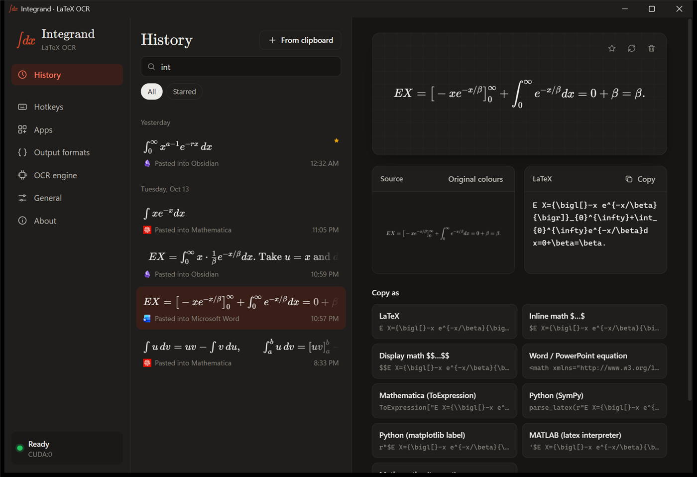

<p align="center"></p>

<h1 align="center">Integrand: LaTeX OCR for your desktop</h1>

<p align="center"><b>Snip any equation on screen and paste it as LaTeX, a Word equation, Mathematica or MATLAB.</b><br>
Free, open source, runs offline. Image to LaTeX in about 0.3 seconds on an NVIDIA GPU.</p>

<p align="center">
  <a href="../../releases/latest"></a>
  <a href="LICENSE"></a>
</p>

<p align="center"></p>

Integrand is a math OCR app that turns a picture of an equation (a PDF, a slide, a scanned paper, a photo, a web page) into LaTeX and pastes it where your cursor is. Press a hotkey, drag over the equation, and the result lands in the program you're typing in, formatted for that program:

| You're in | You get |
| --- | --- |
| Word, PowerPoint, OneNote, Outlook | A native, editable equation |
| Mathematica | `ToExpression["…", TeXForm]` |
| MATLAB | `'$…$'` for the LaTeX interpreter |
| Obsidian, Jupyter, Markdown | `$…$` |
| Anything else | Plain LaTeX |

Recognition runs **on your computer**, so after the one-time setup it works offline and nothing you snip is uploaded. Integrand is a free alternative to cloud equation OCR services. It uses the [Nougat LaTeX](https://huggingface.co/Norm/nougat-latex-base) model. With an NVIDIA GPU a conversion takes about 0.3 s; on the processor alone it takes a couple of seconds.

## Install

1. Download `Integrand_x.y.z_x64-setup.exe` from [Releases](../../releases) and run it. It installs for your user only; no administrator rights needed.
2. Leave **Launch Integrand and set up the recognition engine** checked on the last page.
3. Integrand sets up its recognition engine in three phases:
   - **Before installing**: it checks the graphics card, disk space and that the download servers are reachable, and lists what it will download and why.
   - **Installing**: a private Python, PyTorch built for your hardware, the recognition server and the model go into Integrand's own folder. You don't need Python beforehand, and nothing else on your system changes.
   - **Finishing**: temporary files are removed, a sample equation is recognized as a test, and Integrand switches to the new engine.

### What gets downloaded

| Component | Download | Why |
| --- | --- | --- |
| uv | 22 MB | Installs Python privately |
| Python 3.13 | 30 MB | Runs the recognition server |
| PyTorch | 250 MB (CPU) to 2.6 GB (NVIDIA) | Runs the model; the NVIDIA build bundles the CUDA libraries |
| Server and libraries | 150 MB | latex-ocr-server, Transformers, tokenizers, Pillow, NumPy, gRPC |
| Nougat LaTeX model | 1.4 GB | The trained network itself |

That's about 1.8 GB without an NVIDIA GPU and 3.6 GB with one. Installed, the engine takes 2.4 GB or 4.6 GB.

### Graphics cards

- **NVIDIA** (driver 528 or newer; RTX 50-series needs 570 or newer): runs on the GPU.
- **AMD, Intel, Apple, or no dedicated GPU**: runs on the processor. Same results, a couple of seconds per equation instead of a fraction of one.
- **NVIDIA with an old or missing driver**: setup says so; update the driver and run **OCR engine → Set up or repair** to switch to the GPU.

Already have Python with [`latex-ocr-server`](https://github.com/lucasvanmol/latex-ocr-server) and PyTorch? Choose **Use a Python I already have** instead.

> Windows SmartScreen may warn about an unrecognized app because the installer isn't code-signed yet. Choose **More info → Run anyway**.

## Use

| Default hotkey | Does |
| --- | --- |
| `Ctrl+Alt+S` | Snip part of the screen and paste the result |
| `Ctrl+Alt+L` | Convert the image already on the clipboard and paste it (press again to paste the same equation again) |
| `Ctrl+Alt+H` | Open history |

Left-click the tray icon to open the window:

- **History**: every conversion with its source image. Edit the LaTeX, copy it in any format, star, run recognition again, or drop image files to convert them.
- **Hotkeys**: record new shortcuts and choose what each one does and outputs.
- **Apps**: choose the output format for each program.
- **Output formats**: edit or add templates (`{latex}`, `{latex_str}`, `{latex_sq}`, `{mathml}`).
- **OCR engine**: status, GPU, repair or reinstall the engine.
- **General**: start at login, confirmation popup, theme.

## How it works

```text
hotkey ─► Windows snipping overlay ─► clipboard image
       ─► latex_ocr_server (local gRPC, Python + PyTorch, CUDA-graph decoder)
       ─► format for the focused app ─► clipboard ─► Ctrl+V into that app
```

- `src/`: the Rust app (Tauri 2). `engine.rs` runs the pipeline, `server.rs` talks to the engine and keeps it running, `setup.rs` installs the engine, `platform.rs` holds OS integration, and `formats.rs` turns LaTeX into the output formats (including MathML for Office).
- `ui/`: the window and confirmation popup in plain HTML/CSS/JS with bundled [KaTeX](https://katex.org).
- `engine/`: files the setup installs: pinned Python requirements, a patch that adds a fast CUDA-graph decoder to `latex_ocr_server`, and the model downloader.
- `installer/hooks.nsh`: installer tweaks (Windows version check, finish-page text, stopping the engine on uninstall).

Settings live in `%APPDATA%\com.integrand.desktop`. History, logs, the engine and the model live in `%LOCALAPPDATA%\com.integrand.desktop`. Uninstalling with **Delete the application data** checked removes all of it.

## Build from source

Requires [Rust](https://rustup.rs) and the Tauri CLI:

```sh
cargo install tauri-cli --version "^2"
cargo tauri build   # installer in target/release/bundle/nsis/
cargo tauri dev     # or run a development build
cargo test
```

Pushing a `v*` tag builds the installers on GitHub Actions and attaches them to a draft release (`.github/workflows/release.yml`).

Status: Windows 10/11 is the supported platform. The macOS and Linux code paths compile but haven't been tested yet. Contributions are welcome.

## Licenses

Integrand is MIT licensed (see [LICENSE](LICENSE)). It builds on:

- [latex-ocr-server](https://github.com/lucasvanmol/latex-ocr-server) by Lucas Van Mol (MIT), installed by the setup and patched for speed.
- [Norm/nougat-latex-base](https://huggingface.co/Norm/nougat-latex-base), the recognition model, downloaded from Hugging Face at setup. Its card lists Apache-2.0, but it is fine-tuned from [facebook/nougat-base](https://huggingface.co/facebook/nougat-base), which is **CC-BY-NC-4.0**, so treat the model as non-commercial.
- [PyTorch](https://pytorch.org) (BSD), [Transformers](https://github.com/huggingface/transformers) (Apache-2.0), [uv](https://github.com/astral-sh/uv) (MIT/Apache-2.0).
- [Tauri](https://tauri.app), [KaTeX](https://katex.org), [pulldown-latex](https://github.com/carloskiki/pulldown-latex) and the other Rust crates in `Cargo.toml` (MIT/Apache-2.0).
